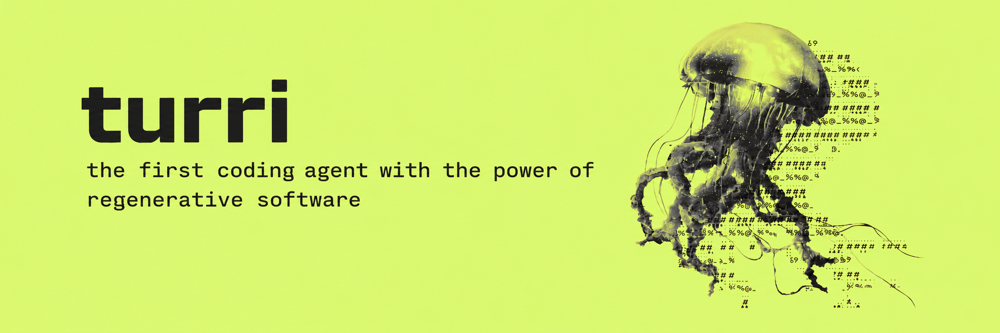
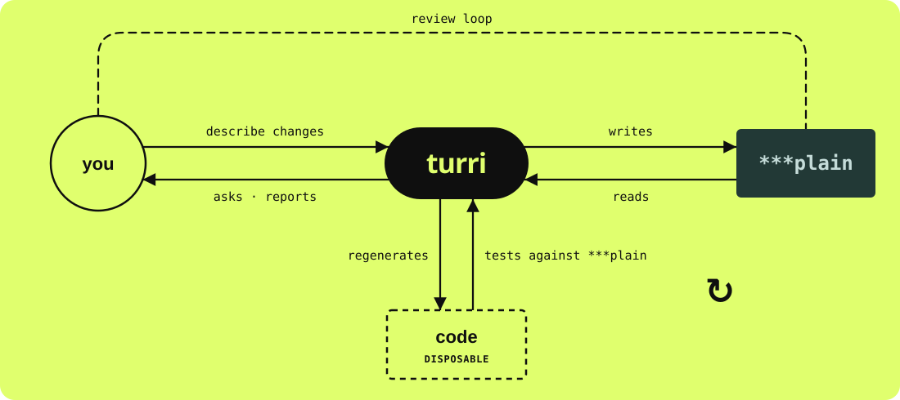

<p align="center"></p>

<h1 align="center">turri<br>the first coding agent with the power of<br>regenerative software<br>&nbsp;</h1>

<p align="center">
  <a href="https://www.npmjs.com/package/@turri-rs/cli"></a>
  <a href="LICENSE"></a>
  <a href="https://nodejs.org/en/download"></a>
</p>

You tell **turri** what the system should do, and **turri** writes it down as [\*\*\*plain](https://plainlang.org/)
specs. **turri** builds the code from them. From then on the specs are the durable source of truth: the code can
always be regenerated from them, and healed against them, as they change.

**turri** is named after *Turritopsis dohrnii*, the immortal jellyfish that regenerates itself from its young
form, again and again - as **turri** regenerates the code from the spec - see [the name](#the-name).

## Quick start

**turri** is built on [pi](https://pi.dev), the coding agent, and runs wherever pi runs: macOS, Linux, WSL; native
Windows best effort, with Git Bash. You need git, bash and [Node](https://nodejs.org/en/download) 22.19 or newer - a
Linux distribution's own `nodejs` package is often older. The agents use this machine's toolchains, fenced by a command check and an audit everywhere, and an OS sandbox where the
OS has one - Seatbelt on macOS, bubblewrap on Linux (`apt install bubblewrap`) - see [installation](docs/installation.md#installation).

```bash
npm install -g @turri-rs/cli # puts `turri` on your PATH
turri doctor              # checks the machine
```

To work on turri itself, run it from a clone instead - see [installation](docs/installation.md#from-a-clone).

`doctor` checks for Node 22.19+, bash, the OS sandbox and a model provider for pi; in a project, the toolchains its
modules need, what its testing scripts run against this machine, and that each model `config.turri.yaml` names
answers with your credentials. It changes nothing without asking: when a check fails - the OS sandbox does not start,
say - it says why, and the command for you to run. Run it again whenever something breaks. What each check means:
[installation](docs/installation.md).

Then start it in your project, signed in to your model providers:

```bash
cd ~/my-project
turri init-config              # asks which vendor you use: Anthropic, OpenAI, Google, Amazon Bedrock, or other
export ANTHROPIC_API_KEY=...   # the key it names - or skip it, and type /login in turri once it has started
turri
```

`turri init-config` asks which vendor's models you use and writes the project's `config.turri.yaml` with two of theirs - a
capable one you talk to, which writes the specs and plans the work, and a smaller, cheaper one that writes the code.
For Anthropic:

```yaml
harness-model: anthropic/claude-opus-5-5:medium  # you talk to it: it writes the specs and plans the work
coding-model: anthropic/claude-haiku-5-5:low     # it writes the code
```

To skip the question, name the vendor - `anthropic`, `openai`, `google`, `amazon-bedrock` (with `--maker` and
`--region`) or `other`:

```bash
turri init-config --vendor anthropic
```

It then tells you which API key to set - or to type `/login` once **turri** is running instead. **turri** loads the
`config.turri.yaml` in the folder you start it from.
Below the two models, the file sets every other setting to its default - change any of them in the file, or from the
chat with `/turri-config`. Any other model works too: [models](#models).

Once `turri` is running, say: *Let's start a new project: a small API where people can register and sign in.*

No project of your own yet? Grow one of [**the examples**](examples/README.md) with turri, step by step.

Rather not install Node and the rest? **turri** also runs in Docker, from one image: [turri in Docker](docker/README.md).

Choosing models: [models](#models); what to do next: [use](#use).

## Why

In the age of coding agents, writing code is getting easy. The hard and important part is
defining what the system should do. Agents can fix bugs, ask questions and keep getting more
capable - but they still cannot read your mind. The question is not only whether an agent can
write the code, but whether it understands what it is building.

Code that is patched, prompt after prompt, drifts: every misunderstanding stays in it, and the
next change is made on top. When the software can always be regenerated from durable information
instead, that understanding is written down - explicit, reviewable and tested - and it grows with
the software rather than against it.

## How it differs from ye old coding agent

With a coding agent you work on code: you ask for a change, it edits the code, and you review the
code it wrote.

With **turri** you work on [\*\*\*plain](https://plainlang.org/) specs. You say what the software must do, and **turri** updates the [\*\*\*plain](https://plainlang.org/) specs
and can always regenerate the code from that. You don't review the code or keep it - you review and
keep the intent: what the software must do, and what must hold as it changes. The specs are the
durable part. The code is a disposable artefact, rebuilt from them whenever they change.

| | ye old coding agent | **turri** |
| --- | --- | --- |
| **What you maintain** | the code, patched prompt after prompt | the [\*\*\*plain](https://plainlang.org/) specs; the code is generated from them and never edited by hand |
| **Who drives** | the agent picks what to do next | the harness, in a fixed order: one functionality or one spec diff at a time, or a whole module functionality by functionality, in the spec's order, each on top of the ones before it |
| **What counts as done** | the agent writes the code, runs the tests, and decides for itself that it is done | ye old coding agent writes the code; **turri** runs the whole test suite itself, with the project's own testing scripts, and decides deterministically when it is done - every test passes in its own run, or the work goes back |
| **Tests** | written and changed by whoever writes the code | conformance tests written from the spec, black box, and kept apart from your acceptance tests; an agent fixing the code cannot change them |
| **What the agent sees** | your whole machine | only the prompt the harness writes, its module's folders, and the public web through its search and fetch tools; every command it runs is checked, fenced and audited |
| **Memory** | one conversation that fills up | a fresh agent for every step, starting from working notes the agents before it left - dated, attributed, and never allowed to override the spec |
| **When it gets stuck** | it keeps trying, or quietly works around the problem | after 20 attempts it stops and tells you what to change in the spec - never in the code |
| **A change** | another patch on top | a change to the spec: what it touches is rebuilt, everything built before is tested again, and code that disagrees with the spec is healed to match |
| **History** | whatever you commit | every build, regeneration and repair is a commit; a build interrupted halfway starts again from the last one |

## How it works

<p align="center"></p>

1. **Define.** Write the specs with **turri**: it interviews you one question at a time and
   writes the `.plain` files, held to the [\*\*\*plain](https://plainlang.org/) authoring rules and reviewed by independent
   judges.
2. **Generate.** **turri** builds the code one functionality at a time, each on top of the ones
   before it, into `plain_modules/` - and builds each answer in the background while the interview
   goes on.
3. **Validate.** The harness runs the unit tests, then conformance tests written from the spec,
   then everything built so far, and moves on only when all of it passes.
4. **Regenerate.** To change the system, change its definition. The functionalities whose spec
   changed are rebuilt, and everything built before is tested again.

A bug is fixed in the spec; a new behaviour goes into the spec; and the next regeneration carries
it. When a build is done, ask to try it: **turri** puts what is built in `dist/<module>` and
starts it on your machine - an app, and it tells you where to open your browser.

A spec looks like this:

```plain
***definitions***

- :User: is a person with an account: an email address and a password.

***implementation reqs***

- :Implementation: is written in Python 3.12 with FastAPI.

***functional specs***

- A new :User: can register with an email address and a password.
  - Registering with an email address already in use fails with status 400.

- A registered :User: can sign in and receives a bearer token.
```

Each item under `***functional specs***` is one functionality, built on top of the ones before it.

**turri** runs as an extension to [pi](https://github.com/earendil-works/pi), so you work with it
in a conversation, and as a command line for unattended runs.

## The name

**turri** is short for [*Turritopsis dohrnii*](https://en.wikipedia.org/wiki/Turritopsis_dohrnii), the immortal
jellyfish, which, when injured or old, turns back into its young self and grows again - the same jellyfish, from the
same genes, again and again.

That is what regenerative software asks of software, and what **turri** does:

| *Turritopsis dohrnii* | **turri** |
| --- | --- |
| Its genes are what it is: every generation grows from the same ones. | The [\*\*\*plain](https://plainlang.org/) spec is what the software is: every generation of code grows from it. |
| Injured or old, it does not patch itself: it goes back to the polyp and grows the adult again. | Code that has drifted is not patched prompt after prompt: it is grown again from the spec, as much of it as has to be. |
| Every cell can become another, and it is still the same jellyfish. | Every line of code can be replaced, and it is still the same software - because what it is never lived in the code. |
| It can do it again and again, for as long as it lives. | The code can be grown again whenever the spec changes or a model gets better, for as long as the spec is kept. |

So the tools speak its language: **`regenerate`** grows the code again from the spec as it is now, **`drift`** says how far
the code has moved from it, **`rejuvenate`** grows again what is grown - functional specs, or a codebase back from the start - and **`lineage`**
shows every generation of a module and what each grew from.

## Models

`init-config`'s models are only a starting point. **turri** is built on [pi](https://github.com/earendil-works/pi),
so any model pi supports works - Anthropic, OpenAI, Google, Amazon Bedrock, OpenRouter, a local one. A model is reached
as pi reaches it - `/login`, in `turri` as in `pi`, the provider's API key in the environment (`ANTHROPIC_API_KEY`,
`OPENAI_API_KEY`, `GEMINI_API_KEY`, ...), or a cloud account - and named as pi names it, `provider/model-id`, with
`:high`, `:low` and so on for how hard it thinks. It uses three: the **harness** model you talk
to, which writes the specs and plans the work - worth a capable one - and the **coding** and
**judge** models its agents build and judge with, which can be smaller and cheaper, such as GPT-6
Luna or Gemini 3.1 Flash Lite. `turri --harness-model` and `--coding-model` choose them for a
session, and pi's `/model` switches the one you talk to as you go; to keep them for the project,
set them with `/turri-config harness-model`, `/turri-config coding-model` and so on - each role's too, as
`models.<role>` - or write them in its `config.turri.yaml`:

```yaml
harness-model: anthropic/claude-opus-5-5    # the model you talk to: a capable one
coding-model: openai/gpt-6-luna             # writes the code and the tests: a smaller one will do
judge-model: google/gemini-3.1-flash-lite   # judges the conformance runs
```

One left out is the one before it: judge from coding, coding from harness. Every way to set them:
[models](docs/config.md#models).

## Use

In the project where your specs live:

```bash
cd ~/my-project
turri
```

Then talk to it:

> Let's start a new project: a small API where people can register and sign in.

It runs the interview skill, asks you about the problem, the stack and the product, writes the
specs, and builds each one as it is written. While it works:

- the **panel** above the input shows every build - its stage, what its agents are doing, its
  model and cost - and the queue behind it;
- ask to try it at any time - "let me try it" - and **`release`** puts what is grown so far in
  `dist/<module>` and **`activate`** starts it, installing what it needs - nothing to approve;
- the **side panel** (`ctrl+h`) takes the screen and opens on **regen** (`/regen`) - the spec, every item marked built, growing, planned or waiting - and `p` turns it to the **pulses** (`/pulses`) - every pulse, growing, planned and finished, and what each grows; what its agents did is in each pulse's log in `.turri/jobs/`;
- **`/halt`** halts a pulse, **`/lineage`** shows what grew into a
  module, and the **`drift`** tool says what is left to grow;
- **`/btw <question>`** asks turri something on the side - answered at once, even in the middle of a skill's interview
  (typed as the answer, under "Something else…"), and left out of the conversation;
- **`/turri-config`** changes any setting of the project's `config.turri.yaml` - the models, review, conformance tests,
  how many pulses at once - and says when it takes effect: now, at your next message, or at the next pulse. No
  restart: `/turri-config review false`, or `/turri-config` alone to pick from the list;
- **`/stack`** chooses the stack to build with, in a project whose backend and frontend each have their own testing
  scripts in `config.turri.<stack>.yaml` - `/stack backend`, `/stack none` - for the session (`--stack <name>` on the
  command line).

Other things to ask for:

> Add password reset to the spec.
>
> Regenerate the whole module, and bind every functional spec to conformance tests.
>
> Grow spec changes with a faster model.

The last one holds for the rest of the session; the model can be chosen separately for spec
changes and for functionalities, and a name that fits more than one model is asked about rather
than guessed.

Without a conversation, the same work is on the command line:

```bash
turri validate app.plain    # validate a spec - no model, no API key
turri drift app.plain       # what is left to grow - starts nothing
turri regenerate app.plain      # grow the code from the spec: planned into jobs, run until it is grown
turri regenerate app.plain 3    # grow functionality 3 again, changed or not
```

More: [using **turri**](docs/using.md); to render a spec overnight, see
[running unattended](docs/headless.md).

## Documentation

Start at the [documentation index](docs/README.md), or go straight to a page:

| | |
| --- | --- |
| [Installation](docs/installation.md) | doctor, what turri needs of this machine, **turri** and `pi`, environment variables |
| [Examples](examples/README.md) | projects to grow with turri step by step: cognio from an empty folder, a CLI, a backend service with conformance tests, a REST API integration |
| [Using **turri**](docs/using.md) | the conversation, skills, tools, pulses and regen, choosing models, the command line |
| [The project config](docs/config.md) | `config.turri.yaml` and each stack's `config.turri.<stack>.yaml`: every key, models and their inheritance, conformance, the testing scripts, stacks and choosing one, the old `config.yaml` |
| [Deploy](docs/deploy.md) | trying what is built: the last commit in `dist/<module>`, started on your machine, nothing installed without asking |
| [Running unattended](docs/headless.md) | rendering a spec overnight or in CI: the command, keeping it running, the results, resuming, rebuilding one functionality |
| [Authoring \*\*\*plain](docs/authoring-plain.md) | what a spec is made of, the authoring rules, the skills that write and fix specs, checking a spec |
| [Growing](docs/growing.md) | what each build does and in which order: functionalities, modules, regeneration, spec diffs, conformance and acceptance tests, working notes, what the code is built from |
| [The sandbox](docs/sandbox.md) | what agents can reach, the walls every command passes, time limits, the web tools |
| [Skills and gates](docs/skills-and-gates.md) | the gate syntax, what the harness enforces, judges, rules |
| [The \*\*\*plain parser](docs/parser.md) | the TypeScript port, `turri validate`, fidelity to the reference parser |
| [Theming](docs/theming.md) | the two brand themes |
| [Development](docs/development.md) | tests, layout, known edges |

## License

turri is open source, under the [MIT licence](LICENSE).
